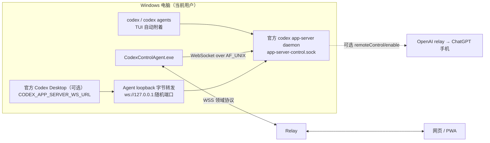

# 网页远程控制本机 Codex：根因、现状与推荐路线

日期：2026-10-24。本机基线：Codex Desktop `26.1021.3705.0`，内置 `codex-cli 0.164.0-alpha.11.1`。本文是研究结论和改造建议，**尚未改动 Agent/Relay 代码**；文中“实测”均在隔离的临时 `CODEX_HOME` 中完成，没有启动用户的 daemon、没有改动 Desktop、配置或认证文件。

## 1. 结论

1. **问题出在拓扑，不在 UI，也不在 Relay。** Codex 的一个 Thread 同一时间只能在一个 app-server 进程里“活着”（加载、写入、产生事件）。Windows 上的官方 Desktop 永远启动自己私有的 stdio app-server，所以任何第三方都无法通过公开协议订阅或控制 Desktop 正在运行的 Turn。项目里“Desktop 外部会话只读”“恢复后在另一个应用中打开”“共享模式要专用快捷方式、退出 Desktop、manifest 校验”这些问题，都是这个约束的不同表现。
2. **只有两种拓扑能做到“完美”**：
   - **A. 官方 Remote Control**：ChatGPT 手机 App 经 OpenAI relay 控制 Desktop。体验完整、零维护；但控制端只能是手机 App（或另一台 Desktop），不能用浏览器，也不能自托管。
   - **B. 一个运行时，多个客户端**：Desktop、TUI 和 Agent 连到同一个 app-server，网页经 Relay 和 Agent 操作它。这是 Codex Control 唯一能长期站住的方向。
3. **Codex 0.164 让 B 第一次有了官方基础**：CLI 新增了 `codex app-server daemon`（官方常驻共享运行时，Windows 可用）、控制套接字、`codex app-server proxy`、`codex agents`，以及 daemon 上的 `remoteControl/*`。TUI 默认自动附着 daemon。**唯一缺口**：Windows 版 Desktop 被硬编码为不接入 daemon，只能继续使用未文档化的 `CODEX_APP_SERVER_WS_URL`。
4. **建议的产品定位**：把 Codex Control 做成“单一运行时的自托管控制面”。
   - 默认模式改为“共享运行时”，独立 stdio 模式降级为兼容模式。
   - 运行时优先使用官方 daemon，Agent 通过控制套接字接入。
   - 本地交互以 `codex` / `codex agents` 为一等入口。
   - Desktop 共享接入改为一个托盘按钮即可完成的可选增强，不再依赖多份脚本和快捷方式。
   - 如果只需要用手机遥控，并且接受 OpenAI 托管的 relay，直接用官方 Remote Control 更省事。Codex Control 的独特价值是：浏览器（电脑和手机）、自托管、多设备和审计。

## 2. 本机实测证据（2026-10-24）

| 项目 | 结果 |
| --- | --- |
| Desktop 当前后端 | `ChatGPT.exe` 的子进程：`codex.exe -c features.code_mode_host=true app-server --analytics-default-enabled -c plugins.codex-app-tools@openai-bundled.mcp_servers.codex_app.enabled=true`，使用 stdio，没有 `--listen` |
| 0.164 新命令 | `codex app-server daemon {bootstrap,start,restart,update,enable-remote-control,disable-remote-control,stop,version}`、`codex app-server proxy`、`codex remote-control {start,stop,pair}`、`codex agents`、顶层 `--no-daemon` |
| 新传输 | `--listen unix://`（默认 `%CODEX_HOME%\app-server-control\app-server-control.sock`，AF_UNIX）。WebSocket 鉴权支持 `--ws-auth capability-token`（`--ws-token-file` / `--ws-token-sha256`）和 `signed-bearer-token` |
| 控制套接字协议 | 隔离实测：`codex app-server --listen unix://` 正常监听。通过 `codex app-server proxy` 发送 HTTP Upgrade，返回 `101 Switching Protocols` 和 `x-codex-websocket-max-unfragmented-message-bytes: 16777216`。**结论：套接字上跑的是 WebSocket，`proxy` 只是原样转发字节** |
| 套接字目录 | 自定义路径的目录必须只有当前用户可访问，否则报 `socket directory is not private to the current user` |
| daemon 启动 | 用 Desktop 内置 CLI 执行 `daemon start` 报 `this CLI has no complete local package`。daemon 需要独立安装的 CLI 包（官方 README 的 Windows bootstrap 步骤）。本次未安装 |
| Desktop 是否接入 daemon | 包内只读检查到的条件：`process.platform!=='win32' && CODEX_APP_SERVER_USE_LOCAL_DAEMON==='1' && …`。**Windows Desktop 不会接入 daemon** |
| Desktop 外部服务入口 | 仍为 `process.env.CODEX_APP_SERVER_WS_URL ?? hostConfig.websocket_url`。`CODEX_APP_SERVER_FORCE_CLI=1` 会禁用该入口。与 26.930 的行为一致，仍未文档化 |
| 0.164 协议规模（`generate-json-schema --experimental`） | 175 个请求、85 个通知、11 个服务端请求。与本项目相关的有 `remoteControl/{enable,disable,status/read,pairing/start,pairing/status,client/list,client/revoke}`、`thread/loaded/list`、`thread/unsubscribe`、`thread/started`、`thread/queue/*`、`thread/readState/*`、`thread/settings/updated` |

## 3. 官方远程能力现状（外部资料）

- 2026-05-14 起，ChatGPT iOS/Android 内置 Codex 远程控制（preview）。在 Desktop 的“设置 > Connections > Control this Mac or PC”中扫码配对；任务仍在主机上执行，经 OpenAI relay 连接，不把主机暴露到公网。官方文档写明 macOS 和 Windows 主机都支持。
- 远程可以：新建或继续会话、追加和干预、审批命令、查看 diff / 终端 / 测试 / 截图、接收完成通知。文档没有说明 chatgpt.com 桌面浏览器可以作为控制端。
- CLI 路线 `codex remote-control start/pair/stop` 仍是实验功能。官方文档与 CLI 说法不一致（openai/codex#35928），0.163 在 Linux 上配对超时（openai/codex#55337）。
- daemon README：支持 Linux/macOS/Windows。Windows 需要在非提权终端中运行，套接字地址受 AF_UNIX 108 字节限制；所有共享客户端继承 daemon 启动时的环境变量；生命周期接口仍可能变化。

## 4. 为什么一直“不完美”：现象与根因

| 现象 | 根因 |
| --- | --- |
| Desktop 正在运行的会话，网页只能看历史，不能实时观察和干预 | 事件只在 Desktop 私有的 stdio app-server 内部流转 |
| 网页“恢复并接管”Desktop 会话后出现冲突或“在另一个应用中打开” | 两个 app-server 同时加载同一个 Thread，争用写入锁和 rollout |
| 共享模式需要专用快捷方式、先退出 Desktop、校验 manifest | Desktop 只在启动时读取环境变量；隐藏入口没有官方生命周期 |
| Desktop 升级后共享模式可能失效 | 依赖未文档化的环境变量和包内逻辑 |
| 共享模式下部分 Desktop 功能可能不完整 | Desktop 自带的后端带有 `features.code_mode_host`、内置插件 MCP 等参数，外部服务默认没有 |

UI 改得再好、Relay 补得再多，也无法消除“两个运行时”带来的分裂。之前的 0.5.x 跨进程状态推断、历史轮询，以及 0.6.0 将其撤销，都印证了这一点。

## 5. 方案对比

| 方案 | 控制端 | Desktop 正在运行的会话 | 实时 / Steer / 审批 / 停止 | 稳定性 | 维护成本 | 与仓库规则 |
| --- | --- | --- | --- | --- | --- | --- |
| A 官方 Remote Control | ChatGPT 手机 App、其他 Desktop | ✅ | ✅（远程停止未写入文档） | 官方产品 | 零 | 不涉及本项目 |
| B daemon 单一运行时 + 网页 + TUI | 浏览器（任意设备）、`codex` TUI | 不使用 Desktop | ✅ | 官方 daemon（实验） | 中 | ✅ 公开 JSON-RPC |
| C = B + Desktop 共享接入 | 浏览器、TUI、Desktop | ✅ | ✅（已在 0.160 现场交叉验收） | 依赖隐藏入口 | 中高 | ⚠️ 未文档化入口，需用户明确授权 |
| D 当前独立 stdio 模式 | 浏览器 | ❌ 只读 | 仅限 Agent 托管的 Thread | 稳定 | 低 | ✅ |
| E UI 自动化 / 注入 / 读取私有 IPC | — | — | — | 脆弱 | 高 | ❌ 禁止 |

## 6. 推荐架构

要点：

1. **运行时归属**：优先使用官方 daemon（每个 `CODEX_HOME` 单实例、pidfile、`daemon.lock` 串行化、可自动更新）。检测不到独立 CLI 包时，退回 Agent 现有的 `SharedRuntimeHost`，改为 `--listen unix://` 加目录 ACL，替代无鉴权的 TCP 端口。
2. **Agent 传输层**：新增 AF_UNIX 连接。.NET 8 可直接实现：`SocketsHttpHandler.ConnectCallback` 连到 `UnixDomainSocketEndPoint`，再用 `ClientWebSocket.ConnectAsync(uri, new HttpMessageInvoker(handler), ct)`，上层沿用现有共享 WS 适配器（watch/send、序号、恢复）。不用改协议、Relay 或 PWA。
3. **Desktop 接入（仅 Windows）**：由于 Desktop 只认 `ws://`，Agent 在 `127.0.0.1` 随机端口开一个 TCP↔AF_UNIX 的**纯字节转发**（控制套接字本身就是 WebSocket，无需解析帧）。托盘只提供一个“以共享模式打开 Codex Desktop”按钮：检查 Desktop 未运行，为子进程设置环境变量，记录实例身份。替代现有 7 个快捷方式脚本。
4. **功能一致性**：把 Desktop 自带后端的 `-c features.code_mode_host=true`、内置插件 MCP 等参数同步到共享运行时的启动配置，并验证 Computer Use、插件、可视化目录在共享模式下可用。
5. **会话归属规则**：任何 Thread 都不在第二个 app-server 中 resume。Agent 通过进程树（`ChatGPT.exe → codex.exe app-server`，无 `--listen`）识别“Desktop 私有运行时”。识别到时，网页不再提供“恢复并接管”Desktop 会话，改为引导“切换到共享模式”。watch 结束时调用 `thread/unsubscribe`，避免 Thread 永久驻留。
6. **发现新会话**：`thread/list` 加 `thread/loaded/list` 做初始发现，`thread/started` 通知做增量。不使用历史轮询。
7. **官方 relay 共存（可选）**：同一个 daemon 执行 `remoteControl/enable` 后，ChatGPT 手机 App 和 Codex Control 网页可以同时控制同一个运行时；配对码在 Agent 中通过 `remoteControl/pairing/start` 展示。

## 7. 分阶段实施

| 阶段 | 内容 | 验收 |
| --- | --- | --- |
| P0 状态透明 | 网页显示运行时拓扑：“共享运行时 / Desktop 独立运行（会话只读）”；当 Agent 识别到 Desktop 私有运行时时，隐藏“恢复并接管” | Playwright 覆盖两种拓扑提示，不再出现冲突入口 |
| P1 daemon 接入 | AF_UNIX WebSocket 连接；自动检测 daemon（`daemon version` JSON），未运行时由用户确认后 bootstrap / start | 真实 daemon 上的 watch/send/steer/interrupt/approval，与 `codex` TUI 双端交叉 |
| P2 Desktop 共享 | 托盘一键共享启动加 loopback 转发；同步 Desktop 参数；移除旧脚本入口 | Desktop ↔ 网页双向消息、Steer、审批、停止；Desktop/Agent/网页分别退出并重连 |
| P3 官方 relay 共存 | Agent 展示 `remoteControl` 状态、配对与客户端撤销 | 手机 App 与网页同时观察同一个 Turn |

## 8. 风险与待验证

- daemon、`remote-control` 都标注为实验功能，生命周期和 JSON 输出可能变化；版本升级后需要重跑 `generate-json-schema` 和真实测试。
- Windows 上启动 daemon 需要独立 CLI 安装包，Desktop 内置 CLI 不能直接启动 daemon。
- `CODEX_APP_SERVER_WS_URL` 未文档化，任何 Desktop 版本都可能移除或改变它。方案 C 必须保留“失败即停、不悄悄退回第二个 stdio 服务”的原则。
- loopback 字节转发对本机所有进程可见（与当前共享模式相同）。不需要 Desktop 接入时应关闭该转发，只保留受 ACL 保护的 AF_UNIX。
- 所有共享客户端继承 daemon 启动时的环境，没有按客户端隔离。
- AF_UNIX 地址不能超过 108 字节，`CODEX_HOME` 路径不宜过长。

## 资料来源

- [openai/codex: app-server-daemon README](https://github.com/openai/codex/blob/main/codex-rs/app-server-daemon/README.md)
- [Remote connections（OpenAI 文档）](https://learn.chatgpt.com/docs/remote-connections)
- [Work with Codex from anywhere（OpenAI）](https://openai.com/index/work-with-codex-from-anywhere/)
- [9to5Mac：ChatGPT 移动端加入 Codex 控制](https://9to5mac.com/2026/05/14/openai-brings-codex-control-to-chatgpt-for-iphone-and-android/)
- [openai/codex#35928：Remote Connections 文档与 CLI 配对流程冲突](https://github.com/openai/codex/issues/35928)
- [openai/codex#55337：0.163 Linux 配对超时](https://github.com/openai/codex/issues/55337)
- [Roboin：仅用 Codex CLI 开启 Remote Control（Windows 绕行）](https://roboin.io/article/en/2026/08/19/enable-remote-control-using-codex-cli/)
- [Daniel Vaughan：Remote Control RPC 与 Remodex 生态](https://codex.danielvaughan.com/2026/06/06/codex-cli-remote-control-mobile-pairing-app-server-v2-remodex/)
